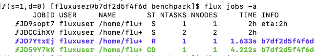

..
    Copyright 2023 Lawrence Livermore National Security, LLC and other
    Benchpark Project Developers. See the top-level COPYRIGHT file for details.

    SPDX-License-Identifier: Apache-2.0

#############################
 Build and Run an Experiment
#############################

**Glossary terms:** :ref:`Benchmark <beginner-tutorial-glossary-benchmark>`,
:ref:`Experiment <beginner-tutorial-glossary-experiment>`, :ref:`System
<beginner-tutorial-glossary-system>`

In this example, we show how to repeat an experiment, that is to run the same
application experiment on the same system using the same hardware and software stack. As
the task often involves the environment of a specific user, it may be challenging for
multiple users to repeat each other’s experiments. All components are kept exactly the
same when repeating an experiment: system hardware, system software, and application.
The only thing that is different in this case is that a new user is running it, or the
same user is rerunning at a different time. Performance of the application is expected
to be the same (or within an expected deviation in the case of an application with
variable runtime).

.. figure:: /_static/images/benchpark-repeat-table.png
    :alt: Benchpark replicate specification
    :width: 50%
    :align: center

Initialize the AWS tutorial system:

.. code-block:: console

    benchpark]$ benchpark system init --dest=hpc-tutorial fluxtainer instance_type=amd64-aws

The ``amd64-aws`` instance type selects 32 cores per node in the generated system
configuration.

Then, initialize the HPL experiment:

.. code-block:: console

    benchpark]$ benchpark experiment init hpc-tutorial hpl +strong caliper=time,mpi

Create the experiment workspace:

.. code-block:: console

    benchpark]$ benchpark setup hpc-tutorial/hpl wkp

The ``setup.sh`` script generated by ``benchpark setup`` activates Benchpark's Spack and
Ramble environments.

.. code-block:: console

    benchpark]$ . wkp/setup.sh

The ``wkp`` directory contains ``ramble``, ``spack``, ``spack-packages``, and
``hpc-tutorial/hpl/workspace`` sub-directories. The ``ramble`` and ``spack`` directories
contain the source for those respective tools. The ``spack-packages`` directory contains
a Spack packages repository. The ``hpc-tutorial/hpl/workspace`` directory contains the
Ramble workspace for the experiments in this tutorial.

At this point, move into the workspace directory to continue with the remaining steps:

.. code-block:: console

    benchpark]$ cd wkp/hpc-tutorial/hpl/workspace

Within this workspace, we can see what experiments we have configured:

.. code-block:: console

    workspace]$ ramble --workspace-dir . workspace info

This should print the following output:

.. code-block:: console

    Workspace: workspace

    Location: /home/fluxuser/benchpark/wkp/hpc-tutorial/hpl/workspace

    Experiments:
      Application: hpl
        Workload: standard
          Experiment 1: hpl.standard.hpl_standard_test_mpi_caliper_time_mpi_strong_scaling_1_1000_1
          Experiment 2: hpl.standard.hpl_standard_test_mpi_caliper_time_mpi_strong_scaling_2_1000_2
          Experiment 3: hpl.standard.hpl_standard_test_mpi_caliper_time_mpi_strong_scaling_4_1000_4
          Experiment 4: hpl.standard.hpl_standard_test_mpi_caliper_time_mpi_strong_scaling_8_1000_8

We can see from this that this workspace will execute 4 experiments currently.

.. code-block:: console

    workspace]$ ramble --workspace-dir . workspace setup

At this point, Ramble has used Spack to install HPL, and configure the experiment
directories for you. We'll explore the experiment directories later, but to see the
output from spack you can open the setup log for the first experiment:

.. code-block:: console

    workspace]$ nano logs/setup.latest/hpl.standard.hpl_standard_test_mpi_caliper_time_mpi_strong_scaling_1_1000_1.out

If you explore this file, you should see output related to ``spack concretize`` and
``spack install``. For more information on what these content mean, please refer to
Spack's documentation. At the bottom of the file, you can see all of the phases Ramble
executed to set up these experiments, along with timing data for each of these.

Now, run the experiments:

.. code-block:: console

    workspace]$ ramble --workspace-dir . on

This command submits the batch scripts (e.g., submission scripts) generated in ``ramble
workspace`` to the system's resource manager (which is specified in the files generated
by ``benchpark system init``). For the AWS infrastructure used in this tutorial, the
resource manager is LLNL's `Flux resource manager <https://flux-framework.org/>`_.

If the above command is successful, you should see something like:

.. code-block:: bash

    ==> Streaming details to log:
    ==>   /home/fluxuser/benchpark/wkp/hpc-tutorial/hpl/workspace/logs/execute.2026-07-09_18.14.08.out
    ==>   Executing 4 out of 4 experiments:
    ==>   Log files for experiments are stored in: /home/fluxuser/benchpark/wkp/hpc-tutorial/hpl/workspace/logs/execute.2026-07-09_18.14.08
    ==> Running executors...
    ƒV54uD5o5
    ƒV57fKkEK
    ƒV5ANUS6s
    ƒV5D498h5

The final lines printed by the ``ramble on`` command are the job IDs produced by the
system resource manager. You can use these IDs to track the progress of the jobs in your
experiment. For example, with Flux, you can see job status by running:

.. code-block:: bash

    flux jobs -a

This command will produce an output like:

.. note::

    If you are running on our `AWS infrastructure
    <https://github.com/llnl/benchpark-tutorial>`_, it should take roughly 1 minute for
    all jobs to finish running. Additionally, only one job will run at a time under our
    infrastructure because each user only has 1 node. If you are running on an HPC
    system, expect the jobs to complete faster.

After the jobs have drained out of the queue, we can analyze them using:

.. code-block:: console

    workspace]$ ramble --workspace-dir . workspace analyze

And we can examine the contents of the ``results.latest.txt`` file:

.. code-block:: console

    workspace]$ nano results.latest.txt

This file should contain the GFLOPs rating for the HPL experiment that you ran, in
addition to information about the software stack, and variants used.

Each experiment directory (i.e., subdirectories of ``experiments/hpl/standard``) will
now contain a Caliper output file (i.e., a ``.cali`` file) containing performance data
for the job. For individual experiment instances, rerunning experiments, and combining
workspaces into one allocation, see :doc:`/run-experiment`.

***********************
 Choose Your Next Step
***********************

.. tutorialcontainer:: tutorial-next-steps

    .. tutorialcontainer:: tutorial-next-step tutorial-goal-search

        :ref:`I have run an experiment someone gave me on the same system. I want to
        start another workflow by searching what is available in Benchpark.
        <search-benchpark>`

    .. tutorialcontainer:: tutorial-next-step tutorial-goal-run-substitute

        :doc:`I want to re-run this experiment and substitute a different compiler or
        library.
        <build-and-run-with-clang>`

    .. tutorialcontainer:: tutorial-next-step tutorial-goal-troubleshoot

        :doc:`My experiment did not finish, and I want to diagnose where it failed.
        <troubleshoot-a-failed-run>`

    .. tutorialcontainer:: tutorial-next-step tutorial-goal-analyze

        :doc:`I want to analyze the performance of an experiment on my system by
        generating preconfigured performance figures. <benchpark-analyze>`

    .. tutorialcontainer:: tutorial-next-step tutorial-goal-query

        :doc:`I want to generate raw performance data to make my own figures.
        <benchpark-query>`
