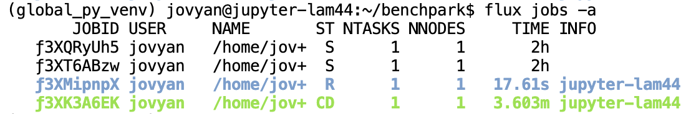

..
    Copyright 2023 Lawrence Livermore National Security, LLC and other
    Benchpark Project Developers. See the top-level COPYRIGHT file for details.

    SPDX-License-Identifier: Apache-2.0

#############################
 Build and Run an Experiment
#############################

**Glossary terms:** :ref:`Benchmark <beginner-tutorial-glossary-benchmark>`,
:ref:`Experiment <beginner-tutorial-glossary-experiment>`, :ref:`System
<beginner-tutorial-glossary-system>`

Initialize the AWS tutorial system:

.. code-block:: console

    ~/benchpark]$ benchpark system init --dest=hpc-tutorial fluxtainer-aws

.. figure:: /_static/images/fluxtainer-aws-system-spec.png
    :alt: Tutorial system spec
    :width: 50%
    :align: center

Then, initialize the HPL experiment:

.. code-block:: console

    ~/benchpark]$ benchpark experiment init --dest=hpl hpc-tutorial hpl +strong caliper=time,mpi

.. figure:: /_static/images/fluxtainer-aws-experiment-spec.png
    :alt: Tutorial experiment spec
    :width: 50%
    :align: center

Create the experiment workspace:

.. code-block:: console

    ~/benchpark]$ benchpark setup hpc-tutorial/hpl wkp

The ``setup.sh`` script generated by ``benchpark setup`` activates Benchpark's Spack and
Ramble environments:

.. code-block:: console

    ~/benchpark]$ . wkp/setup.sh

Set up the Ramble workspace to build HPL and generate each experiment instance:

.. code-block:: console

    ~/benchpark]$ ramble --workspace-dir wkp/hpc-tutorial/hpl/workspace workspace setup

Then, run the experiments:

.. code-block:: console

    ~/benchpark]$ ramble --workspace-dir wkp/hpc-tutorial/hpl/workspace on

This command submits the batch scripts (e.g., submission scripts) generated in ``ramble
workspace`` to the system's resource manager (which is specified in the files generated
by ``benchpark system init``). For the AWS infrastructure used in this tutorial, the
resource manager is LLNL's `Flux resource manager <https://flux-framework.org/>`_.

If the above command is successful, you should see something like:

.. code-block:: bash

    ==> Streaming details to log:
    ==>   /home/fluxuser/benchpark/wkp/hpc-tutorial/hpl/workspace/logs/execute.2026-07-09_18.14.08.out
    ==>   Executing 4 out of 4 experiments:
    ==>   Log files for experiments are stored in: /home/fluxuser/benchpark/wkp/hpc-tutorial/hpl/workspace/logs/execute.2026-07-09_18.14.08
    ==> Running executors...
    ƒV54uD5o5
    ƒV57fKkEK
    ƒV5ANUS6s
    ƒV5D498h5

The final lines printed by the ``ramble on`` command are the job IDs produced by the
system resource manager. You can use these IDs to track the progress of the jobs in your
experiment. For example, with Flux, you can see job status by running:

.. code-block:: bash

    flux jobs -a

This command will produce an output like:

.. note::

    If you are running on our `AWS infrastructure
    <https://github.com/llnl/benchpark-tutorial>`_, it should take roughly 1 minute for
    all jobs to finish running. Additionally, only one job will run at a time under our
    infrastructure because each user only has 1 node. If you are running on an HPC
    system, expect the jobs to complete faster.

After all the jobs are finished, each job directory (i.e., subdirectories of
``wkp/hpc-tutorial/hpl/workspace/experiments/hpl/standard``) will contain a Caliper
output file (i.e., a ``.cali`` file) containing performance data for the job. For
workspace structure and additional build options, see :doc:`/build-experiment`. For
individual experiment instances, rerunning experiments, and combining workspaces into
one allocation, see :doc:`/run-experiment`.

***********************
 Choose Your Next Step
***********************

.. tutorialcontainer:: tutorial-next-steps

    .. tutorialcontainer:: tutorial-next-step tutorial-goal-search

        :ref:`I have run an experiment someone gave me on the same system. I want to
        start another workflow by searching what is available in Benchpark.
        <search-benchpark>`

    .. tutorialcontainer:: tutorial-next-step tutorial-goal-analyze

        :doc:`I want to analyze the performance of an experiment on my system by
        generating preconfigured performance figures. <benchpark-analyze>`

    .. tutorialcontainer:: tutorial-next-step tutorial-goal-query

        :doc:`I want to generate raw performance data to make my own figures.
        <benchpark-query>`
