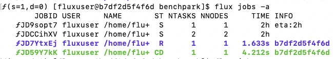

..
    Copyright 2023 Lawrence Livermore National Security, LLC and other
    Benchpark Project Developers. See the top-level COPYRIGHT file for details.

    SPDX-License-Identifier: Apache-2.0

###########################
 Perform a Parameter Sweep
###########################

**Glossary terms:** :ref:`Benchmark <beginner-tutorial-glossary-benchmark>`,
:ref:`Experiment <beginner-tutorial-glossary-experiment>`, :ref:`System
<beginner-tutorial-glossary-system>`

Initialize the AWS tutorial system:

.. code-block:: console

    benchpark]$ benchpark system init --dest=hpc-tutorial fluxtainer-aws

.. figure:: /_static/images/fluxtainer-aws-system-spec.png
    :alt: Tutorial system spec
    :width: 50%
    :align: center

Then, initialize the HPL experiment:

.. code-block:: console

    benchpark]$ benchpark experiment init hpc-tutorial hpl +strong caliper=time,mpi

.. figure:: /_static/images/fluxtainer-aws-experiment-spec.png
    :alt: Tutorial experiment spec
    :width: 50%
    :align: center

Create the experiment workspace:

.. code-block:: console

    benchpark]$ benchpark setup hpc-tutorial/hpl wkp

The ``setup.sh`` script generated by ``benchpark setup`` activates Benchpark's Spack and
Ramble environments.

.. code-block:: console

    benchpark]$ . wkp/setup.sh

The ``wkp`` directory contains ``ramble``, ``spack``, ``spack-packages``, and
``hpc-tutorial/hpl/workspace`` sub-directories. The ``ramble`` and ``spack`` directories
contain the source for those respective tools. The ``spack-packages`` directory contains
a Spack packages repository. The ``hpc-tutorial/hpl/workspace`` directory contains the
Ramble workspace for the experiments in this tutorial.

At this point, move into the workspace directory to continue with the remaining steps:

.. code-block:: console

    benchpark]$ cd wkp/hpc-tutorial/hpl/workspace

Within this workspace, we can see what experiments we have configured:

.. code-block:: console

    workspace]$ ramble --workspace-dir . workspace info

This should print the following output:

.. code-block:: console

    Workspace: workspace

    Location: /home/fluxuser/benchpark/wkp/hpc-tutorial/hpl/workspace

    Experiments:
      Application: hpl
        Workload: standard
          Experiment 1: hpl.standard.hpl_standard_test_mpi_caliper_time_mpi_strong_scaling_1_1000_1
          Experiment 2: hpl.standard.hpl_standard_test_mpi_caliper_time_mpi_strong_scaling_2_1000_2
          Experiment 3: hpl.standard.hpl_standard_test_mpi_caliper_time_mpi_strong_scaling_4_1000_4
          Experiment 4: hpl.standard.hpl_standard_test_mpi_caliper_time_mpi_strong_scaling_8_1000_8

However, we would like to change these experiments to allow us to explore what happens
when the block size in HPL changes.

Before editing the configuration file, we will inspect the HPL application definition,
and see which variables exist. The workload we are using is called ``standard``.

.. code-block:: console

    workspace]$ ramble info hpl --attrs workloads -v -p standard

This will print the information about the standard workload for HPL, but the portion of
interest for this tutorial is:

.. code-block:: console

    NBs:
      Description: NB values
      Default: 1 2 3 4

The ``NB`` parameter in HPL defines the size of the blocks used in the matrix solve. Now
that we know the variable name is ``NBs``, we can edit the configuration file. To do
this, open the ``configs/ramble.yaml`` file in a text editor.

.. code-block:: console

    workspace]$ nano configs/ramble.yaml

Within this file, you should see the following content:

.. code-block:: YAML

    variables:
      N-Grids: 1
      N-NBs: 1
      N-Ns: 1
      NBs: 128
      Ns:
      - 1000
      - 1000
      - 1000
      - 1000
      Ps: '{n_ranks}'
      Qs: '1'
      n_ranks:
      - 1
      - 2
      - 4
      - 8
      n_resources: '{n_ranks}'
      process_problem_size: '{Ns}/{n_ranks}'
      total_problem_size: '{Ns}'

The are the variable definitions for the experiments in this workspace. Here you can see
that ``Ns`` and ``n_ranks`` are both vector variables (meaning they have multiple
values). Ramble will implicly zip these together, since they are the same length. This
means the first values of each are grouped together into the first experiment, the
second together, and so on.

You can see there is a definition for ``NBs`` already, that sets it to ``128``. We want
to parameterize this, and make sure the block size is swept over all of our rank sizes
as well. Replace the ``NBs`` definition with the following:

.. code-block:: YAML

    NBs:
    - 64
    - 100
    - 128
    - 150
    - 256

Now that we have defined additional ``NBs`` values, we need to tell Ramble how to
construct experiments from this definition. Ramble requires that each experiment has a
unique name (to avoid aliasing issues). The current experiment name template in this
file looks like the following:

.. code-block:: YAML

    hpl_standard_test_mpi_caliper_time_mpi_strong_scaling_{n_ranks}_{Ns}_{Ps}:

Add the value of ``NBs`` to this, as in the following:

.. code-block:: YAML

    hpl_standard_test_mpi_caliper_time_mpi_strong_scaling_{n_ranks}_{Ns}_{Ps}_{NBs}:

Finally, we need to tell Ramble that we want experiments to be generated by computing
the cross-product of ``NBs`` with the other (already zipped) variables from our existing
experiments. To do this, we need to add a ``matrix`` definition within the experiment
template block. In the experiment block, there is already a definition:

.. code-block:: YAML

    matrix: []

Replace this with:

.. code-block:: YAML

    matrix:
    - NBs

This tells Ramble to consume the ``NBs`` variable as a dimension of a matrixed set of
experiments. Since we already have the other variables implicly zipped, Ramble will
implicitly add those as the final dimension of the matrix. It is also possible to make
this definition explicit for the sake of readability. This would look like the
following:

.. code-block:: YAML

    matrix:
    - NBs
    - ranks_config
    zips:
      ranks_config
      - n_ranks
      - Ns

This would require removing the ``zips: {}`` definition as well. However it is not
necessary in this tutorial. Now, set up the experiments:

.. code-block:: console

    workspace]$ ramble --workspace-dir . workspace setup

At this point, Ramble has used Spack to install HPL, and configure the experiment
directories for you. Now, run the experiments:

.. code-block:: console

    workspace]$ ramble --workspace-dir . on

This command submits the batch scripts (e.g., submission scripts) generated in ``ramble
workspace`` to the system's resource manager (which is specified in the files generated
by ``benchpark system init``). For the AWS infrastructure used in this tutorial, the
resource manager is LLNL's `Flux resource manager <https://flux-framework.org/>`_.

If the above command is successful, you should see something like:

.. code-block:: bash

    ==> Streaming details to log:
    ==>   /home/fluxuser/benchpark/wkp/hpc-tutorial/hpl/workspace/logs/execute.2026-07-09_18.14.08.out
    ==>   Executing 4 out of 4 experiments:
    ==>   Log files for experiments are stored in: /home/fluxuser/benchpark/wkp/hpc-tutorial/hpl/workspace/logs/execute.2026-07-09_18.14.08
    ==> Running executors...
    ƒV54uD5o5
    ƒV57fKkEK
    ƒV5ANUS6s
    ƒV5D498h5

The final lines printed by the ``ramble on`` command are the job IDs produced by the
system resource manager. You can use these IDs to track the progress of the jobs in your
experiment. For example, with Flux, you can see job status by running:

.. code-block:: bash

    flux jobs -a

This command will produce an output like:

.. note::

    If you are running on our `AWS infrastructure
    <https://github.com/llnl/benchpark-tutorial>`_, it should take roughly 1 minute for
    all jobs to finish running. Additionally, only one job will run at a time under our
    infrastructure because each user only has 1 node. If you are running on an HPC
    system, expect the jobs to complete faster.

After the jobs have drained out of the queue, we can analyze them using:

.. code-block:: console

    workspace]$ ramble --workspace-dir . workspace analyze

This creates a file in the root of the workspace named ``results.latest.txt``. We can
now open this file to explore the results of our experiments:

.. code-block:: console

    workspace]$ nano results.latest.txt

This file should contain the GFLOPs rating for the HPL experiments that you ran, in
addition to information about the software stack, and variants used.

To make the results easier to compare across configurations, we can add a table
definition to the Ramble configuration. Open the ``ramble.yaml``:

.. code-block:: console

    workspace]$ nano configs/ramble.yaml

And add the following to the bottom of the configuration file. Make sure it is indented
a base of two spaces.

.. code-block:: YAML

    tables:
    - name: parameter_sweep
      columns:
      - name: "N Ranks"
        expression: "{n_ranks}"
      - name: "Matrix Size"
        expression: "{Ns}"
      - name: "Block Size"
        expression: "{NBs}"
      - name: GFlops
        figure_of_merit: "GFlops"
        figure_of_merit_context: "N-NB-P-Q = {Ns}-{NBs}-{n_ranks}-1"

Now, re-analyze the experiments:

.. code-block:: console

    workspace]$ ramble --workspace-dir . workspace analyze

This time, the last lines of the output should be about creating tables. You can now
explore the generated table using:

.. code-block:: console

    workspace]$ cat tables/parameter_sweep.latest.csv

Additionally, each experiment directory (i.e., subdirectories of
``experiments/hpl/standard``) will now contain a Caliper output file (i.e., a ``.cali``
file) containing performance data for the job. For individual experiment instances,
rerunning experiments, and combining workspaces into one allocation, see
:doc:`/run-experiment`.

***********************
 Choose Your Next Step
***********************

.. tutorialcontainer:: tutorial-next-steps

    .. tutorialcontainer:: tutorial-next-step tutorial-goal-search

        :ref:`I have run an experiment someone gave me on the same system. I want to
        start another workflow by searching what is available in Benchpark.
        <search-benchpark>`

    .. tutorialcontainer:: tutorial-next-step tutorial-goal-analyze

        :doc:`I want to analyze the performance of an experiment on my system by
        generating preconfigured performance figures. <benchpark-analyze>`

    .. tutorialcontainer:: tutorial-next-step tutorial-goal-run-substitute

        :doc:`I want to re-run this experiment and substitute a different compiler or
        library.
        <build-and-run-with-clang>`

    .. tutorialcontainer:: tutorial-next-step tutorial-goal-query

        :doc:`I want to generate raw performance data to make my own figures.
        <benchpark-query>`
