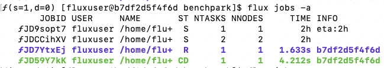

..
    Copyright 2023 Lawrence Livermore National Security, LLC and other
    Benchpark Project Developers. See the top-level COPYRIGHT file for details.

    SPDX-License-Identifier: Apache-2.0

######################################
 Troubleshoot a Failed Experiment Run
######################################

**Glossary terms:** :ref:`Experiment <beginner-tutorial-glossary-experiment>`,
:ref:`System <beginner-tutorial-glossary-system>`, :ref:`Scaling Study
<beginner-tutorial-glossary-scaling-study>`

In this example, we show how to repeat an experiment, that is to run the same
application experiment on the same system using the same hardware and software stack.
This use case follows the same steps to create an HPL workspace as in
:doc:`build-and-run-experiment`, but we will run into build and run errors and follow
the clues from the Ramble output to understand the reason for the failure.

*********************
 What You Will Learn
*********************

When a Benchpark run fails, first identify which phase failed:

- ``benchpark system init`` and ``benchpark experiment init`` create Benchpark
  configuration files.
- ``benchpark setup`` creates the Ramble workspace.
- ``ramble workspace setup`` builds the software and creates experiment instances.
- ``ramble on`` submits the generated experiment scripts to the scheduler.

This tutorial focuses on a failure from ``ramble on`` because those failures usually
mean the benchmark launched but one experiment instance did not finish correctly.

.. figure:: /_static/images/benchpark-repeat-table.png
    :alt: Benchpark replicate specification
    :width: 50%
    :align: center

Initialize the AWS tutorial system:

.. code-block:: console

    benchpark]$ benchpark system init --dest=hpc-tutorial fluxtainer instance_type=amd64-aws

The ``amd64-aws`` instance type selects 32 cores per node in the generated system
configuration.

Then, initialize the HPL experiment:

.. code-block:: console

    benchpark]$ benchpark experiment init hpc-tutorial hpl +strong Ns=-1 caliper=time,mpi

Create the experiment workspace:

.. code-block:: console

    benchpark]$ benchpark setup hpc-tutorial/hpl wkp

The ``setup.sh`` script generated by ``benchpark setup`` activates Benchpark's Spack and
Ramble environments.

.. code-block:: console

    benchpark]$ . wkp/setup.sh

The ``wkp`` directory contains ``ramble``, ``spack``, ``spack-packages``, and
``hpc-tutorial/hpl/workspace`` sub-directories. The ``ramble`` and ``spack`` directories
contain the source for those respective tools. The ``spack-packages`` directory contains
a Spack packages repository. The ``hpc-tutorial/hpl/workspace`` directory contains the
Ramble workspace for the experiments in this tutorial.

At this point, move into the workspace directory to continue with the remaining steps:

.. code-block:: console

    benchpark]$ cd wkp/hpc-tutorial/hpl/workspace

Within this workspace, we can see what experiments we have configured:

.. code-block:: console

    workspace]$ ramble --workspace-dir . workspace info

This should print the following output:

.. code-block:: console

    Workspace: workspace

    Location: /home/fluxuser/benchpark/wkp/hpc-tutorial/hpl/workspace

    Experiments:
      Application: hpl
        Workload: standard
          Experiment 1: hpl.standard.hpl_standard_test_mpi_caliper_time_mpi_strong_scaling_1_-1_1
          Experiment 2: hpl.standard.hpl_standard_test_mpi_caliper_time_mpi_strong_scaling_2_-1_2
          Experiment 3: hpl.standard.hpl_standard_test_mpi_caliper_time_mpi_strong_scaling_4_-1_4
          Experiment 4: hpl.standard.hpl_standard_test_mpi_caliper_time_mpi_strong_scaling_8_-1_8

We can see from this that this workspace will execute 4 experiments currently.

Before setting up the Ramble workspace, we will explore a few error cases.

To begin, we will explore what happens when you analyze the workspace before any data
has been created.

.. code-block:: console

    workspace]$ ramble --workspace-dir . workspace analyze

This command should print an error like the following:

.. code-block:: console

    ==> Error: No analyzeable experiment detected. Make sure your workspace is setup with
        ramble workspace setup

Additionally, we can attempt to run ``benchpark analyze`` using the following:

.. code-block:: console

    workspace]$ benchpark analyze --workspace-dir .

This will print the following error:

.. code-block:: console

    INFO:benchpark.cmd.analyze: Found 0 .cali files for analysis.
    Traceback (most recent call last):
      File "/home/fluxuser/benchpark/bin/benchpark", line 35, in <module>
        exit_code = main()
                    ^^^^^^
      File "/home/fluxuser/benchpark/lib/main.py", line 169, in main
        exit_code = action(args)
                    ^^^^^^^^^^^^
      File "/home/fluxuser/benchpark/lib/benchpark/cmd/analyze.py", line 842, in command
        prepare_data(**vars(args))
      File "/home/fluxuser/benchpark/lib/benchpark/cmd/analyze.py", line 382, in prepare_data
        tk = th.Thicket.from_caliperreader(
             ^^^^^^^^^^^^^^^^^^^^^^^^^^^^^^
      File "/home/fluxuser/.local/lib/python3.12/site-packages/thicket/thicket.py", line 459, in from_caliperreader
        return Thicket.reader_dispatch(
               ^^^^^^^^^^^^^^^^^^^^^^^^
      File "/home/fluxuser/.local/lib/python3.12/site-packages/thicket/thicket.py", line 573, in reader_dispatch
        raise ValueError("Iterable must contain at least one file")
    ValueError: Iterable must contain at least one file

Next we will manufacture a few errors related to the Spack build, to help show where
these errors show up. Update the spec used to install HPL as follows:

.. code-block:: console

    workspace]$ ramble --workspace-dir . workspace manage software -o --pkg hpl --spec hpl-err@2.3-caliper~openmp~foo+caliper --prefix spack

Set up the Ramble workspace to build HPL and generate each experiment instance:

.. code-block:: console

    workspace]$ ramble --workspace-dir . workspace setup

This will fail with an error similar to the following:

.. code-block:: console

    ==> Error: Software spec hpl is not defined in environment hpl, but is required by the spack application definition

This error comes from Ramble, in an attempt to make sure the package you need to perform
the experiment is added into the environment that is going to be built using Spack. In
this case, we changed the package name from ``hpl`` to ``hpl-err`` which triggers the
error. Now, change the package name back:

.. code-block:: console

    workspace]$ ramble --workspace-dir . workspace manage software -o --pkg hpl --spec hpl@2.3-caliper~openmp~foo+caliper --prefix spack

Set up the Ramble workspace to build HPL and generate each experiment instance:

.. code-block:: console

    workspace]$ ramble --workspace-dir . workspace setup

This will fail with an error similar to the following:

.. code-block:: console

    ==> Error: Command exited with status 1:
        '/home/fluxuser/benchpark/tutorial-workspaces/wkp/spack/bin/spack' 'concretize' '-U' '-f'
    ==> Error: Error running spack command: /home/fluxuser/benchpark/tutorial-workspaces/wkp/spack/bin/spack concretize -U -f
    ==> Error: For more details, see the log file: /home/fluxuser/benchpark/tutorial-workspaces/wkp/hpc-tutorial/hpl/workspace/logs/setup.<date_stamp>/hpl.standard.hpl_standard_test_mpi_caliper_time_mpi_strong_scaling_1_-1_1.out

The last line of this error message points to a log file that contains additional
information. Ramble stores high level logs within this ``logs/`` subdirectory of the
workspace. Opening this file, we see an error close to the bottom that says:

.. code-block:: console

    ==> Error: No such variant {'foo'} for spec: 'hpl@2.3-caliper~foo+caliper~openmp'

This error tells us that the ``foo`` variant we added in the spec is not actually
defined in the HPL Spack package. To fix this, we can change the spec back to what it
was before. This can be done using either the command line:

.. code-block:: console

    workspace]$ ramble --workspace-dir . workspace manage software -o --pkg hpl --spec hpl@2.3-caliper~openmp+caliper --prefix spack

Or by editing the Ramble workspace configuration file (you can use your favorite
editor):

.. code-block:: console

    workspace]$ nano configs/ramble.yaml

And removing ``~foo`` from the HPL spec in the ``packages:`` configuration section.
(After editing, save and exit using Ctrl+O <enter> followed by Ctrl+X)

Now, set up the experiments again:

.. code-block:: console

    workspace]$ ramble --workspace-dir . workspace setup

At this point, Ramble has used Spack to install HPL, and configure the experiment
directories for you. We'll explore the experiment directories later, but to see the
output from spack you can open the setup log for the first experiment:

.. code-block:: console

    workspace]$ nano logs/setup.latest/hpl.standard.hpl_standard_test_mpi_caliper_time_mpi_strong_scaling_1_-1_1.out

If you explore this file, you should see output related to ``spack concretize`` and
``spack install``. For more information on what these content mean, please refer to
Spack's documentation. At the bottom of the file, you can see all of the phases Ramble
executed to set up these experiments, along with timing data for each of these.

Now, run the experiments:

.. code-block:: console

    workspace]$ ramble --workspace-dir . on

This command submits the batch scripts (e.g., submission scripts) generated in ``ramble
workspace`` to the system's resource manager (which is specified in the files generated
by ``benchpark system init``). For the AWS infrastructure used in this tutorial, the
resource manager is LLNL's `Flux resource manager <https://flux-framework.org/>`_.

If the above command is successful, you should see something like:

.. code-block:: bash

    ==> Streaming details to log:
    ==>   /home/fluxuser/benchpark/wkp/hpc-tutorial/hpl/workspace/logs/execute.2026-07-09_18.14.08.out
    ==>   Executing 4 out of 4 experiments:
    ==>   Log files for experiments are stored in: /home/fluxuser/benchpark/wkp/hpc-tutorial/hpl/workspace/logs/execute.2026-07-09_18.14.08
    ==> Running executors...
    ƒV54uD5o5
    ƒV57fKkEK
    ƒV5ANUS6s
    ƒV5D498h5

The final lines printed by the ``ramble on`` command are the job IDs produced by the
system resource manager. You can use these IDs to track the progress of the jobs in your
experiment. For example, with Flux, you can see job status by running:

.. code-block:: bash

    flux jobs -a

This command will produce an output like:

.. note::

    If you are running on our `AWS infrastructure
    <https://github.com/llnl/benchpark-tutorial>`_, it should take roughly 1 minute for
    all jobs to finish running. Additionally, only one job will run at a time under our
    infrastructure because each user only has 1 node. If you are running on an HPC
    system, expect the jobs to complete faster.

After the jobs have drained out of the queue, we can analyze them using:

.. code-block:: console

    workspace]$ ramble --workspace-dir . workspace analyze

This creates a file in the root of the workspace named ``results.latest.txt``. Opening
this file, we should see the following:

.. code-block:: console

    Experiment hpl.standard.hpl_standard_test_mpi_caliper_time_mpi_strong_scaling_1_-1_1 figures of merit:
      Status = FAILED

And in fact, all of the experiments have failed. To find out why, we can open one of the
experiment log files. Ramble creates independent directories for each experiment within
the ``experiments`` subdirectory of the workspace. Navigate into one of them using:

.. code-block:: console

    workspace]$ cd experiments/hpl/standard/hpl_standard_test_mpi_caliper_time_mpi_strong_scaling_1_-1_1/

Within this directory, you should see the following files:

.. code-block:: console

    execute_experiment - The script that is run for the experiment
    HPL.dat - The input for HPL
    hpl_standard_test_mpi_caliper_time_mpi_strong_scaling_1_-1_1.out - The redirected output from the experiment's execution

Along with several other files. If we open the
``hpl_standard_test_mpi_caliper_time_mpi_strong_scaling_1_-1_1.out`` file, we should see
the following:

.. code-block:: console

    HPL ERROR from process # 0, on line 343 of function HPL_pdinfo:
    >>> Value of N less than 0 <<<

    HPL ERROR from process # 0, on line 621 of function HPL_pdinfo:
    >>> Illegal input in file HPL.dat. Exiting ... <<<

    flux-job: task(s) exited with exit code 1

This means our HPL input was invalid, causing the run to prematurely exit. This all
stems from our addition of ``Ns=-1`` on the ``benchpark experiment init`` line. If we
hadn't added this line, benchpark would have set the value to be ``Ns=1000`` by default.
To fix this, we will navigate back into the workspace root:

.. code-block:: console

    hpl_standard_test_mpi_caliper_time_mpi_strong_scaling_1_-1_1]$ cd ../../../../

Here, open the workspace config file again:

.. code-block:: console

    workspace]$ nano configs/ramble.yaml

In the top portion of the file, you should see a group of variables that are defined.
Some are scalars, some are variable references, some are even lists (i.e. ``n_ranks``).
Ramble uses these when generating the individual experiments within this workspace. Find
the variable definition that looks like:

.. code-block:: console

    Ns:
    - -1
    - -1
    - -1
    - -1

and change all of the ``-1`` to ``1000``. Then save and exit the file. There are
multiple lines with ``-1`` to allow each value of ``n_ranks`` below to have a different
``Ns`` value. Now, delete the old experiment directories to ensure no stale caliper
files exist:

.. code-block:: console

    workspace]$ rm -rf experiments/

Then set up the workspace again:

.. code-block:: console

    workspace]$ ramble --workspace-dir . workspace setup

And re-submit the jobs:

At this point, set up the workspace again:

.. code-block:: console

    workspace]$ ramble --workspace-dir . on

Once the jobs are all finished, we can re-analyze the workspace:

.. code-block:: console

    workspace]$ ramble --workspace-dir . workspace analyze

And we can examine the contents of the ``results.latest.txt`` file:

.. code-block:: console

    workspace]$ nano results.latest.txt

This file should contain the GFLOPs rating for the HPL experiment that you ran, in
addition to information about the software stack, and variants used.

Each experiment directory (i.e., subdirectories of ``experiments/hpl/standard``) will
now contain a Caliper output file (i.e., a ``.cali`` file) containing performance data
for the job. For individual experiment instances, rerunning experiments, and combining
workspaces into one allocation, see :doc:`/run-experiment`.

***********************
 Choose Your Next Step
***********************

.. tutorialcontainer:: tutorial-next-steps

    .. tutorialcontainer:: tutorial-next-step tutorial-goal-search

        :ref:`I have run an experiment someone gave me on the same system. I want to
        start another workflow by searching what is available in Benchpark.
        <search-benchpark>`

    .. tutorialcontainer:: tutorial-next-step tutorial-goal-run-substitute

        :doc:`I want to re-run this experiment and substitute a different compiler or
        library.
        <build-and-run-with-clang>`

    .. tutorialcontainer:: tutorial-next-step tutorial-goal-troubleshoot

        :doc:`My experiment did not finish, and I want to diagnose where it failed.
        <troubleshoot-a-failed-run>`

    .. tutorialcontainer:: tutorial-next-step tutorial-goal-analyze

        :doc:`I want to analyze the performance of an experiment on my system by
        generating preconfigured performance figures. <benchpark-analyze>`

    .. tutorialcontainer:: tutorial-next-step tutorial-goal-query

        :doc:`I want to generate raw performance data to make my own figures.
        <benchpark-query>`
